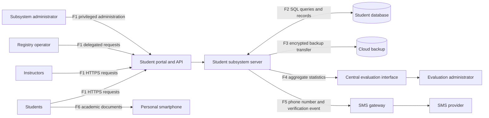

# System Model

## Purpose

This model describes a university student information subsystem that processes student identity, contact, enrollment, grades, study status, and audit information. It supports students, instructors, department registry staff, subsystem administrators, a central evaluation service, a cloud backup provider, and an SMS provider.

## Privacy objectives

- Prevent unnecessary correlation of student activity across contexts.
- Prevent direct and indirect identification beyond an authorized purpose.
- Limit disclosure of academic and contact data.
- Explain processing at the point where it affects the student.
- Enforce purpose, retention, processor, and access obligations.

## Data subjects and actors

| ID | Actor | Role | Privacy relevance |
| --- | --- | --- | --- |
| E1 | Students | View and update records, submit requests, receive verification codes | Primary data subjects |
| E2 | Instructors | Access limited course and student information | Privileged users with constrained purpose |
| E3 | Department registry operator | Processes exceptional or in-person student requests | Delegated processing on behalf of students |
| E4 | Student subsystem administrator | Manages accounts, privileges, and service configuration | Highly privileged role |
| E5 | Central evaluation administrator | Requests statistics or confirmation data | Secondary recipient |
| E6 | SMS provider | Delivers verification messages | External processor or service provider |
| E7 | Cloud storage provider | Stores database backups | External processor or service provider |

## Processes and stores

| ID | Element | Description |
| --- | --- | --- |
| P1 | Student portal and API | Authenticates users and handles student and instructor requests |
| P2 | Student subsystem server | Applies business rules and executes data queries |
| P3 | Central evaluation interface | Produces and sends approved statistics or confirmations |
| P4 | SMS gateway | Sends verification codes and related delivery metadata |
| D1 | Student database | Stores identity, contact, enrollment, grades, and audit records |
| D2 | Cloud backup | Stores protected copies of the student database |

## Trust boundaries

| ID | Boundary | Main concern |
| --- | --- | --- |
| TB1 | User device to university service | Authentication, interception, session correlation |
| TB2 | Student subsystem to central evaluation service | Purpose limitation and re-identification in small groups |
| TB3 | University environment to cloud provider | Processor assurance, encryption, access, transfer, retention |
| TB4 | Student subsystem to SMS provider | Third-party metadata and user awareness |
| TB5 | Personal computer to smartphone over Bluetooth | Unmanaged endpoint and local disclosure |

## Personal data assets

- Identity and contact details
- Academic identity documents
- Enrollment and study status
- Grades and transcripts
- Authentication and verification metadata
- Usage and audit logs
- Statistical outputs that may expose small groups

## Assumptions

- The model represents a teaching scenario rather than a verified production architecture.
- The central evaluation service should receive aggregate data unless a documented purpose requires otherwise.
- Cloud backup and SMS delivery involve third parties.
- Bluetooth transfer occurs outside managed infrastructure.
- Existing controls are treated as unverified until evidence appears in the verification plan.

## DFD overview

